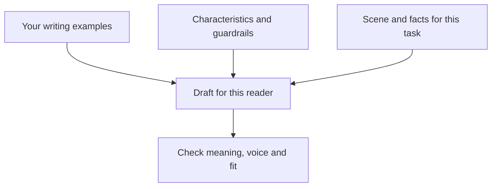
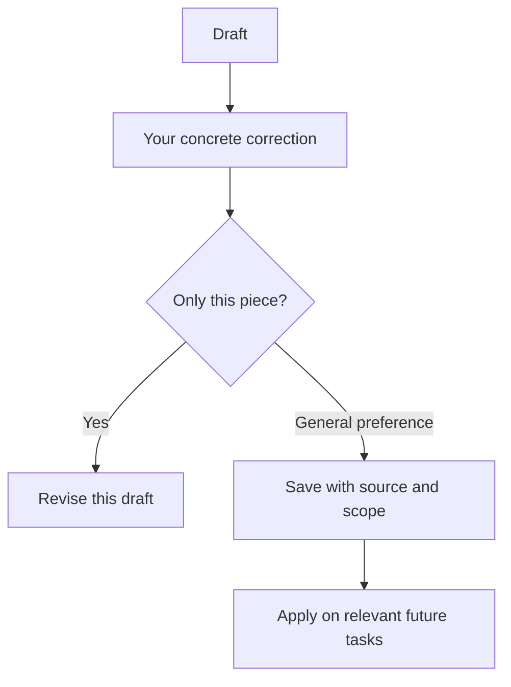

# Velvet

Give AI examples of your writing, a usable voice guide, and the situation it is writing for.

By Monty Singer. A research-informed writing skill built from a review of ten public skills and guides.

## Use it

Download this repository and install the `velvet` folder through your assistant's supported skill workflow, or provide [SKILL.md](SKILL.md) and the relevant references as instructions. Skill loading and persistent memory depend on the host application.

Start with: “Use Velvet to edit this. Here are my writing examples, the reader, and what I want them to understand or do.”

Keep your examples and completed profile private. The supplied [voice reference](references/voice-reference.md) is a blank template. This repository has no credentials, integrations or background jobs.

**Testing status:** eighteen outputs across six synthetic tasks and three conditions passed the initial factual and scope checks. The full skill did not establish an advantage over the basic prompt. Personal voice fit and editing time still need writer-led evaluation. [Read the results](references/evaluation-pilot.md).

## Three inputs, one draft

| Input | What to supply | What it contributes |
| --- | --- | --- |
| Examples | A few passages you wrote or deliberately selected, matched to the task | Rhythm, phrasing and information order |
| Standing guidance | Supported preferences and boundaries | Consistency across tasks |
| Task-specific scene | Reader, relationship, channel, situation, emotional intent and desired action | The right version of your voice for this moment |

## Make characteristics observable

| Vague request | Usable instruction |
| --- | --- |
| Sound natural | Use the supplied examples for openings, sentence rhythm and vocabulary. Preserve phrases that already fit. |
| Be warm | Acknowledge the actual shared context, then make the request easy to answer. |
| Be confident | State the recommendation directly; keep uncertainty where the evidence is uncertain. |
| Be engaging | Lead with the specific problem or consequence this reader cares about. |

Choose relevant dimensions from the [17-characteristic checklist](references/characteristics.md). They are editorial choices, not a scientific taxonomy or seventeen rules every piece must follow.

## What is a scene?

**Task:** Ask a client to approve a homepage draft.

**Scene:** You are writing an email to an existing client after their first review. They are busy and already know the project. You want them to feel that the next step is manageable. Ask them to approve the draft or send edits by Thursday. Approval keeps Friday's planned launch on schedule. Avoid adding pressure, praise or claims about results.

**Illustrative output:**

> Could you approve the homepage draft or send any edits by Thursday? That keeps us on schedule for Friday's launch.

This is an authored illustration of task fit, not a measured model result or a demonstration of a calibrated personal voice.

## Keep different contexts distinct

| Context | Useful examples | What to check |
| --- | --- | --- |
| Client email | Your real client coordination emails | Clear request, appropriate relationship, accurate commitments |
| Personal reflection | Your essays or newsletters | Perspective, rhythm, nuance |
| Spoken video | Your approved scripts and verified transcripts | Sayability, pacing, recognizable phrasing |

Start with 3–5 matched passages as a practical working set, not a validated minimum. Broaden the archive when a task needs coverage the examples do not provide. Label AI-assisted samples as selected preferences rather than evidence of unaided habits. Separate your words from quoted replies and other speakers.

## Improve through explicit edits

Keep raw private examples outside a shareable skill. Save general preferences only when explicitly authorized. This changes instructions and references; it does not train model weights or start a background monitor.

## Test whether it helps

Use several new tasks whose final wording was not used to create the guide. Give the same model the same facts and task, once with its usual instructions and once with this skill. Compare the outputs without labeling which is which. Judge factual preservation, task fit, whether you would say or send it, and how much substantive editing remains. Do not use an AI detector as the success measure.

For a recording, show one real task, its facts, both outputs, and your actual corrections. Describe observed results for that example rather than promising no editing ever again.

## Explore the skill

- [Instructions](SKILL.md)
- [Voice reference and calibration](references/voice-reference.md)
- [Public skill comparison and transferable lessons](references/public-skills.md)
- [Research and limits](references/evidence.md)
- [Scientific rationale and evaluation plan](references/research-design.md)
- [Internal pilot: results and limitations](references/evaluation-pilot.md)

The comparison explains design influences. It is not a ranking or an independent benchmark of the linked tools.
